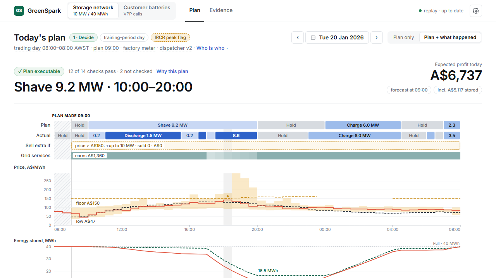

# GreenSpark: electricity price forecasting and battery dispatch

[](https://github.com/Matthew0yuan/GreenSpark/actions/workflows/tests.yml)

A decision-support tool for Western Australia's Wholesale Electricity Market (WEM): forecast prices, plan battery
operation, and evaluate when paying customers to use their batteries adds value. Built as a personal project for
GreenSpark Hackathon 2026



## What it does

- **Battery dispatch:** plans charging, discharging and grid-service participation, with explanations for each decision.
  The app supports a battery behind a factory's meter or connected directly to the grid.
- **Customer-battery calls:** evaluates whether an evening call is worth its compensation cost, subject to a limited
  call budget, and separates the retailer's return from the customers' return.

The app replays historical outcomes and can use live AEMO data for battery planning. It is a research prototype;
market offers and dispatch are simulated, with no orders sent or devices controlled.

## How it works

1. At **09:00**, forecast half-hourly prices and spike risk using data already public at the decision time.
2. Optimise the day's plan within battery and market constraints, accounting for losses, wear and site demand charges.
3. Price discharge offers against the value of keeping energy for later, then re-plan every **30 minutes**.
4. Separately, assess customer-battery calls against expected system peaks, compensation and the remaining call budget.

The dispatcher does not rely on predicting the exact timing of a spike. Customer calls are compared with the same
battery in normal self-consumption mode; compensation is a transfer between parties, not new system value.

## Results and limitations

Methods were developed and selected on **1 Apr 2025–30 Jun 2026 (456 days)**. The frozen-model test covers
**1 Jul–22 Oct 2026 (114 days)**. Test results are reported, not used for selection, but the first 107 days
(1 Jul–15 Oct) were inspected during development; only 16–22 Oct (7 days) were previously unseen.

| Area | Main finding | Scope and limitation |
|---|---|---|
| Price forecast | Test mean absolute error (MAE) was **31% lower** than repeating yesterday's prices: A$19.2 vs A$28.0/MWh. | The 09:00 half-hourly price forecast; test period above. |
| Battery dispatch | Captured **68%** of the market net revenue earned by a reference strategy given the day's prices in advance, compared with **7%** when following the 09:00 plan without further adjustment. | Same simulated 10 MW / 40 MWh factory battery and operating constraints; 1 Jul–22 Oct 2026 (114 test days). Market net revenue is energy trading plus grid services, less battery wear; excludes network-bill and annual capacity-charge savings. Factory load is synthetic; the perfect-price reference is not a proven theoretical optimum. |
| Customer calls | Summer system peaks offered more value than energy-price spikes in the household-battery study. | Contract year 1 Jul 2025–30 Jun 2026, within training. Uses household batteries and an assumed 2027 rule where exports count; results do not establish returns for business customers. |

Customer payment terms are model suggestions, not an approved tariff. The test period has **no summer**, so it does
not validate the capacity-charge savings out of sample. Factory demand-charge savings depend on synthetic load;
forecast errors can still cause actual site demand to exceed the planned level.

## Quick start

With [uv](https://docs.astral.sh/uv/) and Node 22, run from the repository root:

```sh
uv sync --extra app
npm --prefix app/frontend ci
npm --prefix app/frontend run build
uv run python -m app.backend
```

Open [localhost:8000](http://127.0.0.1:8000). By default, the app replays 1 Apr 2025–22 Oct 2026.
Allow about 30 seconds for model loading; the first start also builds storage-value tables and takes about a minute longer.
On Windows, clone into a short path to avoid long-path issues.

<details>
<summary>Live data, tests and Docker</summary>

- **Live data:** `uv run python -m app.live.run --init` initialises `var/live/` and downloads newer AEMO data
  (about 1 GB). Battery planning then uses live inputs; customer-call analysis remains historical.
- **Tests:** `uv run pytest app/tests`. Live-data tests are skipped until live data exist.
- **Docker demo:** after initialising live data, `uv run python deploy/demo.py up` starts the app and a Cloudflare
  quick tunnel; use `url` to show connection details and `down` to stop it. Requires Docker.

</details>

## Documentation

Public implementation and evaluation entry points:

| To explore | Start here |
|---|---|
| App and live-data pipeline | [App](app/), [live-data runner](app/live/run.py), [deployment](deploy/demo.py) |
| Forecasts and battery dispatch | [Forecasts](vpp/forecast.py), [v2 dispatcher](vpp/v2/) |
| Evaluation and saved results | [Evaluation](vpp/evaluate.py), [result tables](reports/) |
| Customer-call model | [Policy optimiser and simulator](vpp/policy/) |

Detailed research write-ups are kept locally and are not published in this repository.

**Stack:** Python · LightGBM · SciPy/HiGHS · FastAPI · React/TypeScript · Vite · pytest/Playwright · Docker.

## Data and licence

- **AEMO:** [public WEM market data](https://data.wa.aemo.com.au), © Australian Energy Market Operator Limited,
  subject to its [copyright permissions](https://www.aemo.com.au/privacy-and-legal-notices).
  Raw downloads are in `data/raw/`; derived tables are in `data/pit/` and `data/processed/`.
  Facility SCADA is excluded; download it with `uv run python scripts/download_wem.py facility-scada` if needed.
- **Weather:** [Open-Meteo](https://open-meteo.com/), ECMWF IFS forecasts, under
  [CC BY 4.0](https://creativecommons.org/licenses/by/4.0/). Hourly forecasts for three locations were converted to
  half-hourly values (instantaneous values interpolated, hourly totals held) and aligned to publication times.
- **Other inputs:** offer-price ceilings from [ERA](https://www.erawa.com.au), WA public holidays from
  [wa.gov.au](https://www.wa.gov.au), and school terms from [education.wa.edu.au](https://www.education.wa.edu.au).

Code is under the [MIT licence](LICENSE). Data retain their sources' terms and are not covered by the code licence.
