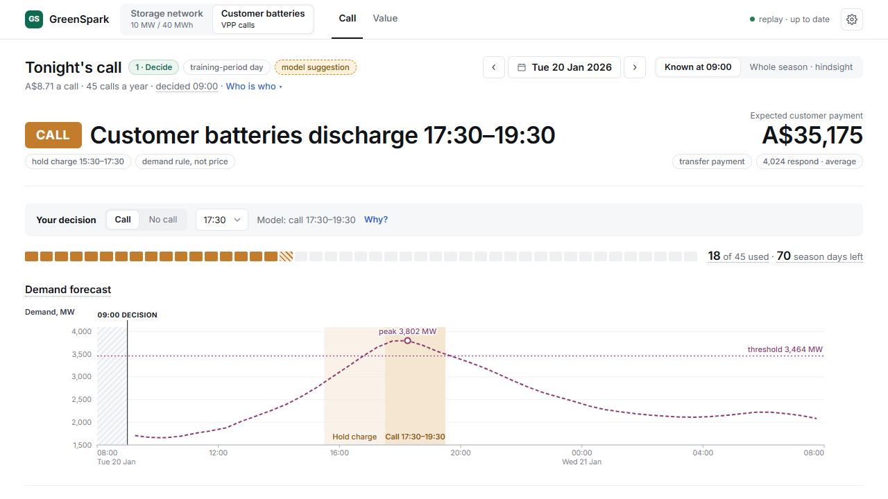

# GreenSpark: battery trading and customer-battery calls in the WA electricity market

[](https://github.com/Matthew0yuan/GreenSpark/actions/workflows/tests.yml)

A personal project built for the GreenSpark Hackathon 2026 (Challenge 02, Western Australia's Wholesale Electricity
Market).


## The problem

Zenith is an electricity retailer with a 10 MW / 40 MWh battery behind a factory's meter. It also wants to pay its
customers to use their batteries. Every morning at 09:00 it has to decide two things:

1. **What its own battery does today.** Grid-service income has collapsed, so the money is now in rare price spikes,
   and no forecast can tell which half-hour a spike will hit.
2. **Whether to call customer batteries this evening.** Every call costs a payment to the customers, and calls are
   limited.

## How it works

Every morning at 09:00:

1. Forecast today's half-hourly prices, and the chance of a price spike, from data already public by 09:00.
2. Plan the battery's day: when to charge, when to discharge, how much to hold back for grid services, and how to keep
   the factory under its demand cap.
3. Put a price on every stored MWh (what it is worth to keep for later) and offer the spare energy at that price. If a
   spike comes, the offer sells; if not, the energy stays.
4. Re-plan every 30 minutes as new prices come in.
5. Decide whether to call customer batteries this evening: only on likely system-peak days, at most 45 times a year.

## What makes it different

- **It does not bet on guessing the spike.** No forecast can say which half-hour will spike, so the battery is never
  all-in on one guess. It keeps energy on offer at a fair price all day and lets the market come to it.
- **Rules first, money second.** The plan is built inside the factory's demand cap, the battery's limits and its
  grid-service commitments, and looks for profit only within them. (When the factory's real load runs above its
  forecast, the meter can still go slightly over the cap.)
- **No peeking.** Each decision uses only data that was public at that moment. The models were frozen on 30 Jun 2026
  and judged on the days after.
- **Judged in dollars, with the rules written first.** A change was kept only if it made more money on the training
  data, under a pass rule written down before the results were seen. A better-looking forecast alone did not count.
- **Fair books for customer batteries.** A call is compared with the customer's battery doing its normal job, not with
  having no battery. Zenith's money and the customers' money are kept apart, so a payment to a customer is never
  counted as value created.
- **It explains itself.** Every decision comes with a plain-English reason and the value of the energy kept. The web
  app runs on live AEMO data and replays what actually happened.

## Results

**How it was tested.** Everything was built and tuned on 1 Apr 2025 – 30 Jun 2026 (456 days, "training"). The models
were then frozen and run on 1 Jul – 22 Oct 2026 (114 days, "test"), days they never learned from. Test results are
only reported, never used to choose anything. One caveat: the first 107 test days were looked at during development;
only the last 7 (16–22 Oct) are completely unseen.

### The factory battery

**Where the money comes from.** Each source as a share of what the battery earns per day (current dispatcher;
rounded):

| | Training | Test |
|---|---|---|
| Lower network bill: keeping the factory's peak demand under its cap | 31% | 72% |
| Grid services (FCESS): being paid to stand by for the grid | 62% | 2% |
| Energy trading: charging when cheap, selling into high prices | 10% | 34% |
| Battery wear (a cost) | −3% | −9% |
| Earnings per day, for scale | A$4,664 | A$2,096 |

In plain words: grid services used to pay most of the money. That income fell 98% in the test period, so the battery
now earns mainly by trimming the factory's peak demand and by selling when prices jump.

**Is it better than the first version?** Yes, in both periods.

- Training: **10% more** money per day (95% interval: 6% to 15%).
- Test: **28% more** per day (12% to 42%). The first 107 test days: 30% more. The last 7 unseen days, a quiet week with
  few spikes: 4% more, too few days to judge.
- It comes out ahead on about two days in three (66% of training days, 64% of test days).

The 95% interval is the range the true gain most likely falls in. Both ranges stay above zero, so the gain is not luck.
They are wide because the network bill is monthly and the test period is only four months long.

**How close to perfect?** Picture a battery that knew every price of the day in advance. In the test period, the
current dispatcher made **68%** of that battery's market income (trading plus grid services, less wear). The first
version made 39%. Making a plan at 09:00 and never changing it made 7%. So most of the money comes from reacting during
the day: re-planning every half-hour and keeping sell offers ready for spikes. In training the three were close (93%,
87%, 86%), because grid services, which every version earned, were most of the money. The perfect-knowledge battery is
a yardstick, not a ceiling: on some spike days the dispatcher beats it.

**The capacity charge (IRCR).** Each summer, the factory's share of the grid's capacity cost is set by how much it
draws in the 12 half-hours of highest demand across the whole system. In summer 2025-26 (training) the battery covered
**all 12 (100%)**, so the factory's share fell to zero, worth about A$2.12M a year on top of the daily figures. The
perfect-knowledge battery covered only 11 of 12 (92%): knowing the prices does not tell you which days will be the
system peaks. The factory's load is made up, so treat the dollar figure as an order of magnitude.

### Forecasts

- **Prices.** The 09:00 forecast of the day's half-hourly prices has a **31% smaller** average error than assuming
  today repeats yesterday (A$19.2 against A$28.0 per MWh; test).
- **Spike days.** The day before, a model flags days likely to have a spike: a half-hour settling at A$150/MWh or more.
  In the test period it flagged 18 days, and **all 18 (100%)** had a spike, against 67% of the other days. In training:
  74% against 41%. Spikes are common either way, but a flagged day is clearly more likely to have one.

### Customer batteries

Zenith would pay customers to discharge their batteries on chosen evenings. This was modelled with a household battery
(13.5 kWh, 5 kW), 10,000 customers offered, and an assumed 2027 capacity-charge rule under which exports count. The
suggested terms: call only on likely system-peak days in summer (1 Dec – 31 Mar), at most 45 times a year, for 2 hours
at 17:30–19:30, paying about A$8.70 a call. These are the model's suggestion, not a real tariff. "2025-26" below is the
contract year 1 Jul 2025 – 30 Jun 2026, inside training.

- **Price spikes alone never pay.** Even with perfect hindsight, a customer battery earns Zenith at most A$8.14 a year
  from energy prices: about a third (33%) of the A$25 a year it costs to serve that customer (2025-26).
- **The money is in the summer peak days.** In 2025-26 the policy used 24 of its 45 calls (53%) and covered 3 of the 4
  official peak days (75%). About 45% of the customers offered would join (from an assumed take-up curve). Each comes
  out about A$145 a year ahead, and Zenith about A$2.08M.
- **Tested on a summer it had not seen.** Chosen using only the two earlier summers, then run on summer 2025-26, the
  policy made 12.5% more than it expected, and 65% more than a policy on Synergy's Battery Rewards terms (70c/kWh, at
  most 30 calls).
- **Why the call budget matters.** In the heavy summer of 2023-24, that Synergy-like policy used up its 30 calls before
  the peak days arrived, covered none of the 4 (0%), and lost money.
- **Test period:** no summer, so no calls; the only cost was running the programme.



### Tried and not adopted

Research runs, compared with the current dispatcher on the training data:

- **Two-stage stochastic MILP** (planning over 20 price scenarios instead of one forecast): at most 0.4% more per day,
  within noise (the 95% interval includes zero); no better in the first 107 test days.
- **A charging bid curve**, solved from the plan at seven price points: 0.06% more per day (−0.5% to +0.6%), so no real
  difference. The test period showed 3.6% more, but test results do not choose.

## Models

| Part | Method |
|---|---|
| Price forecast | LightGBM on the error of AEMO's own pre-dispatch forecast, with ECMWF weather, averaged with a LightGBM model that does not use AEMO's forecast; monthly walk-forward refits |
| Spike risk | LightGBM classifier: the chance of a price of A$200/MWh or more in each half-hour |
| Value of stored energy | Dynamic programming over a year of half-hourly price movements, scaled to the last 28 days' price level |
| Day plan | Mixed-integer linear program (SciPy `milp`, HiGHS): power and energy limits, round-trip losses, battery wear, the factory's demand cap, grid services |
| Sell offers | Layered offers at the value of keeping each MWh, plus wear and a safety margin |
| Customer-battery calls | Call when AEMO's 09:00 demand forecast tops the season's 4th-highest daily peak so far, less a margin learned from past forecast errors |

## Stack

- **Models:** Python 3.13, pandas, NumPy, PyArrow, LightGBM, SciPy (HiGHS), scikit-learn, Matplotlib; uv
- **Backend:** FastAPI and Uvicorn, with the models in worker processes
- **Frontend:** React 19, TypeScript, Vite, TanStack Query, hand-drawn SVG charts
- **Tests:** pytest, Playwright
- **Deploy:** Docker, Cloudflare Tunnel
- **Data:** AEMO's public WEM data (5-minute prices, pre-dispatch, demand, grid-service prices), Open-Meteo (ECMWF);
  sources and terms under [Data](#data)

## Run it

With [uv](https://docs.astral.sh/uv/) and Node 22:

```
uv sync --extra app
cd app/frontend && npm ci && npm run build && cd ../..
uv run python -m app.backend
```

Then open http://127.0.0.1:8000. The app replays the historical days, 1 Apr 2025 – 22 Oct 2026. The models take about
30 seconds to load. On a fresh clone the first start also builds the two storage-value tables (about 90 MB each, not in
git), which adds about a minute.

Tests: `uv run pytest app/tests` (the live-data tests are skipped until live data exist).

On Windows, a few paths under `analysis/` are up to 149 characters long. Clone into a short folder, or run
`git config --global core.longpaths true` before cloning.

**Live data.** `uv run python -m app.live.run --init` copies `data/` into `var/live/` and downloads AEMO's newest days
(about 1 GB). From then on the app runs on live data and rebuilds its inputs each morning.

**Docker.** The public demo runs the app in a locked-down container behind a Cloudflare quick tunnel:
`uv run python deploy/demo.py up` builds and starts it (it needs the live data above), `url` prints the address and
login, `down` stops it. The login is random and kept in `deploy/.env`, which is not in git.

## Limits

- The factory's load is synthetic.
- The customer-battery money uses a household battery model; Zenith's real customers are businesses.
- Customer exports reduce the capacity charge under an assumed 2027 rule.
- The test period has no summer, so the capacity-charge value is checked on past summers only.

## Data

- **AEMO** (Australian Energy Market Operator): WEM market data from [data.wa.aemo.com.au](https://data.wa.aemo.com.au),
  including prices, pre-dispatch, demand, grid-service prices and requirements, outages, ST PASA and facilities.
  © Australian Energy Market Operator Limited, subject to AEMO's
  [copyright permissions](https://www.aemo.com.au/privacy-and-legal-notices). `data/raw/` holds the files as
  downloaded; `data/pit/` and `data/processed/` hold tables derived from them. AEMO's facility SCADA (1.1 GB) is not
  included; `uv run python scripts/download_wem.py facility-scada` downloads it.
- **Weather:** [Weather data by Open-Meteo.com](https://open-meteo.com/), ECMWF IFS forecasts, under
  [CC BY 4.0](https://creativecommons.org/licenses/by/4.0/). Changes: hourly forecasts for three locations were put
  on a half-hour grid (instantaneous values interpolated, hourly totals held) and matched to the time each forecast run
  was public.
- **ERA** (Economic Regulation Authority, WA): the energy and grid-service offer price ceilings,
  from [erawa.com.au](https://www.erawa.com.au) (`data/raw/era/`).
- **Calendars:** WA public holidays ([wa.gov.au](https://www.wa.gov.au)) and school terms
  ([education.wa.edu.au](https://www.education.wa.edu.au)).

## Licence

The code is under the [MIT licence](LICENSE). The data keep their sources' terms above; they are not covered by the
MIT licence.

## Layout

`app/` the web app · `vpp/` the models · `scripts/` data downloads · `data/` market and weather data · `reports/`
result tables · `analysis/` dated experiments: scripts and their outputs (their write-ups are not published) ·
`deploy/` Docker · `agents/` tools used to dispatch and check AI coding agents during development
